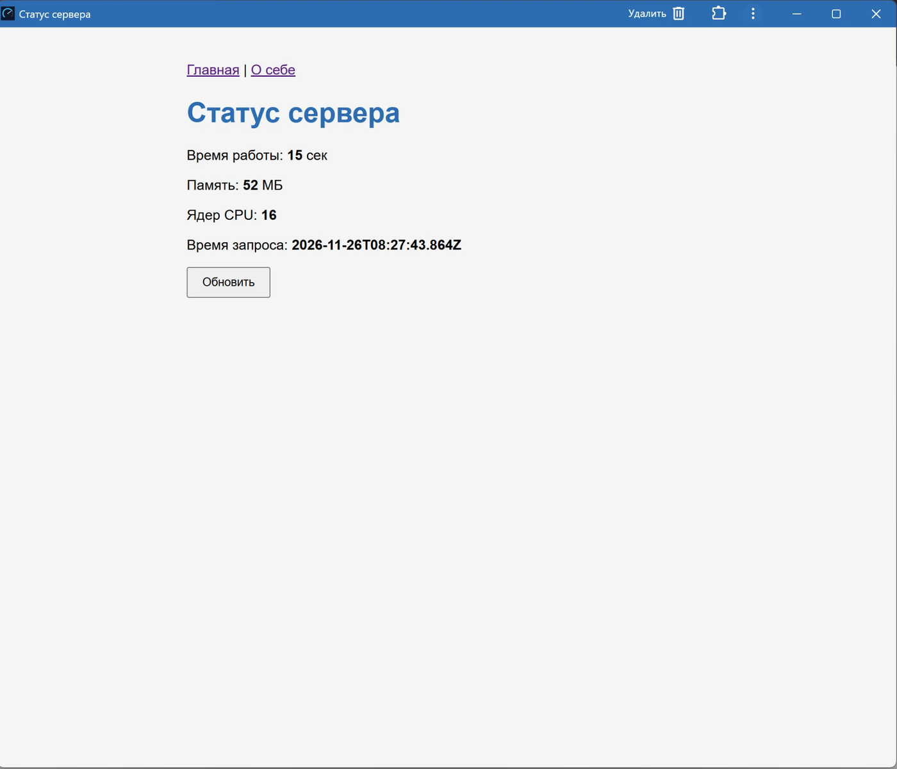

# Монитор сервера

**Монитор сервера** — небольшое веб-приложение, которое показывает, в каком состоянии сейчас работает сервер: сколько времени он запущен, сколько памяти занимает и сколько ядер процессора ему доступно.

Приложение можно открыть в браузере или **установить на компьютер или телефон как обычную программу** (PWA). Оно продолжает открываться, даже если сервер выключен: в этом случае показываются последние полученные данные.

## Для кого и зачем

- **Разработчику** — быстро проверить, что сервер жив, и сколько ресурсов он потребляет.
- **Другим программам** — получить те же данные в формате JSON по адресу `/api/status`, например для системы мониторинга или чтобы встроить их в другой сайт.

## Возможности

- Главный экран с четырьмя показателями: время работы, память, количество ядер CPU, время запроса.
- Кнопка «Обновить» — получить свежие данные без перезагрузки страницы.
- API `/api/status` — те же данные для других программ, в формате JSON.
- Расширенный режим `?details=true` — дополнительно операционная система и версия Node.js.
- Установка как приложение: своя иконка, отдельное окно без адресной строки.
- Работа без сервера: страницы и последние данные открываются из кеша.
- Журнал запросов: каждое обращение к серверу записывается в консоль.

## Как пользоваться

1. Откройте приложение — показатели загрузятся автоматически.
2. Нажмите **«Обновить»**, чтобы получить актуальные значения.
3. Чтобы установить приложение, нажмите значок «Установить» в адресной строке Chrome или Edge.
4. Если сервер недоступен, приложение всё равно откроется и покажет последние сохранённые показатели.

## Скриншоты

Приложение, установленное как PWA:



## Запуск

Нужен установленный [Node.js](https://nodejs.org/).

```
cd Lab6
npm install
npm start
```

Открыть: http://localhost:3000

Остановить: **Ctrl + C** в терминале.

## API

| Метод | Адрес | Ответ |
|---|---|---|
| GET | `/api/status` | `{ uptimeSeconds, memoryUsageMB, cpuCount, timestamp }` |
| GET | `/api/status?details=true` | то же + `platform` и `nodeVersion` |

Пример ответа:

```json
{
  "uptimeSeconds": 125,
  "memoryUsageMB": 52,
  "cpuCount": 16,
  "timestamp": "2026-11-26T10:00:00.000Z"
}
```

| Поле | Что означает | Откуда берётся |
|---|---|---|
| `uptimeSeconds` | сколько секунд работает сервер | `process.uptime()` |
| `memoryUsageMB` | сколько памяти занимает сервер, МБ | `process.memoryUsage()` |
| `cpuCount` | количество ядер процессора | `os.cpus()` |
| `timestamp` | время ответа (ISO, UTC) | `new Date().toISOString()` |

## Страницы

| Адрес | Что открывается |
|---|---|
| `/` | главный экран с показателями |
| `/about` | об авторе и проекте |

## Технологии

Node.js, Express, HTML, CSS, JavaScript, PWA (Web App Manifest, Service Worker).

## Структура проекта

```
Lab6/
├── server.js          — сервер: страницы, API, журнал запросов
├── package.json       — описание проекта и зависимости
└── public/
    ├── index.html     — главный экран
    ├── about.html     — об авторе
    ├── style.css      — оформление
    ├── script.js      — загрузка показателей, регистрация service worker
    ├── manifest.json  — описание приложения для установки (название, иконки)
    ├── sw.js          — service worker: кеш и работа без сервера
    └── icons/         — иконки приложения
```

---

*Проект выполнен в рамках лабораторной работы №6 «Введение в Node.js и базовый сервер на Express», вариант 20.*
